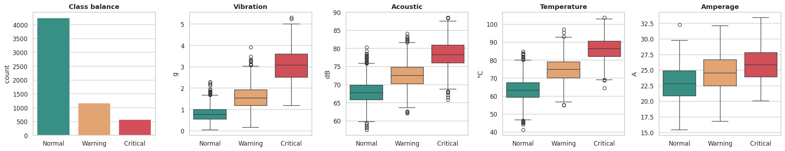
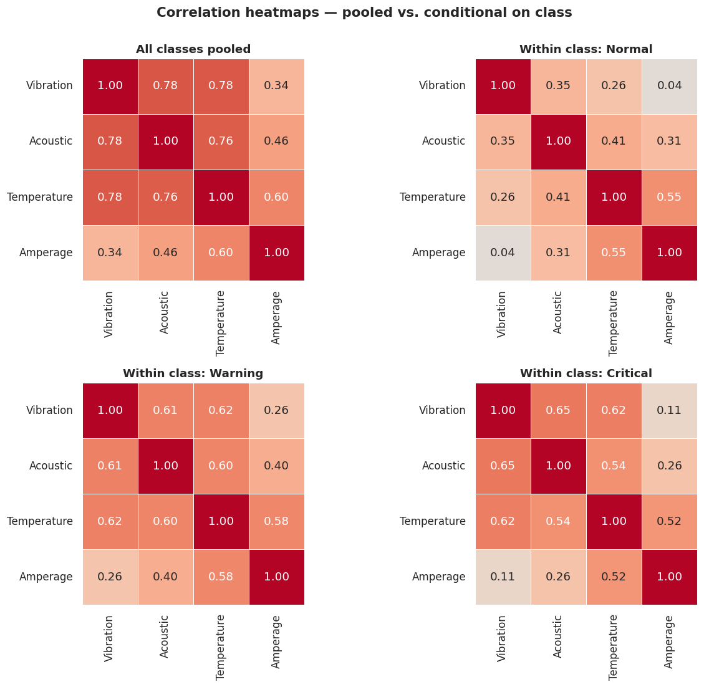
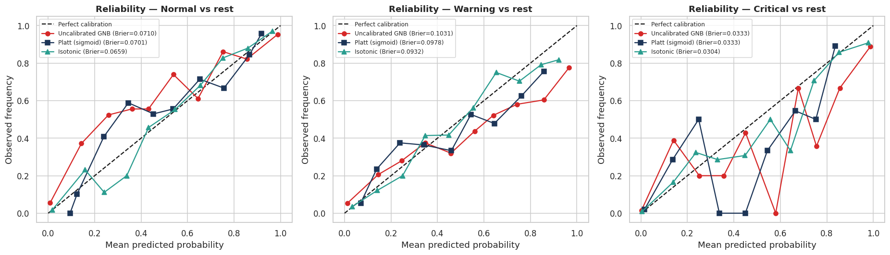
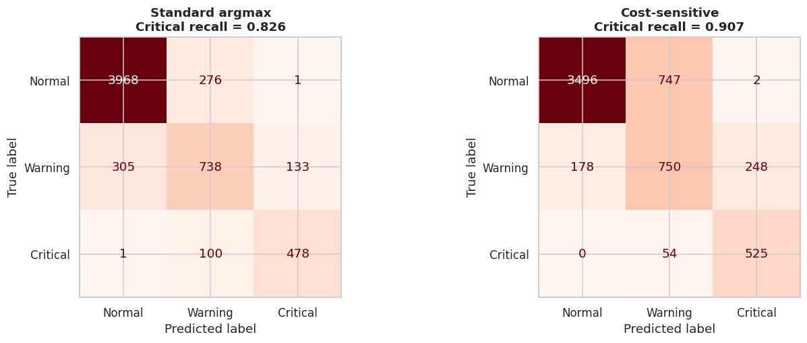
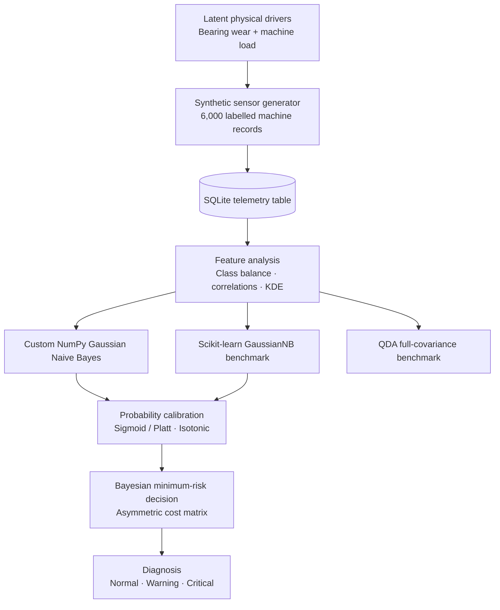

<div align="center">

# Project 42 — Synthetic Sensor Fault Diagnosis

### Physics-inspired telemetry · Gaussian Naive Bayes from scratch · Probability calibration · Cost-sensitive decision intelligence

<p>
  
  
  
  
  
</p>

**Can a simple probabilistic classifier become useful for predictive maintenance when its assumptions are wrong — provided its probabilities are calibrated and its decisions account for operational risk?**

</div>

---

## Overview

Project 42 is a reproducible, notebook-first machine-learning study of **multi-class sensor fault diagnosis** for rotating industrial machinery.

The project generates synthetic machine telemetry from two hidden physical drivers — **bearing wear severity** and **machine load** — then maps those drivers into four observable sensor channels. A custom Gaussian Naive Bayes (GNB) classifier is implemented in NumPy and benchmarked against `sklearn.naive_bayes.GaussianNB`.

The experiment deliberately creates correlated sensor measurements to examine the conditional-independence assumption behind Naive Bayes. It then studies probability calibration with **sigmoid/Platt scaling** and **Isotonic Regression**, compares GNB with **Quadratic Discriminant Analysis (QDA)**, and uses a multiclass **Bayesian minimum-risk decision rule** to prioritize missed Critical faults.

> **Scope:** this is a controlled synthetic-data research prototype. It is not a validated industrial safety system and does not establish real-world maintenance savings.

## Research questions

1. Can a ground-up NumPy implementation reproduce the main outputs of Scikit-learn's GaussianNB?
2. What happens when the sensor features remain correlated *within* each operating class?
3. Can post-hoc calibration improve the reliability of GNB's probability estimates?
4. How does a cost-sensitive decision policy change Critical-fault recall, false alarms, and total simulated cost?

## Results at a glance

The notebook uses a fixed random seed (`42`). Results below are taken from an executed run of the notebook in this repository. **Holdout, cross-validation, calibration, and cost-sensitive results use different evaluation protocols; they are reported separately rather than mixed together.**

| Experiment | Result |
|---|---:|
| Synthetic records | 6,000 |
| Sensor features | 4 |
| Classes | 3 |
| Custom NumPy vs. Scikit-learn maximum probability difference | `1.89 × 10⁻¹⁵` |
| Holdout GNB accuracy (75/25 split) | **87.27%** |
| 5-fold CV accuracy (mean) | **86.40% ± 1.01 pp** |
| 5-fold CV macro-F1 (mean) | **0.7928 ± 0.0142** |
| 5-fold CV macro ROC-AUC, OvR (mean) | **0.9387 ± 0.0093** |
| Holdout ECE: uncalibrated → Isotonic | **0.0687 → 0.0039** |
| OOF Critical recall: argmax → minimum risk | **0.8256 → 0.9067** |
| OOF total illustrative cost: argmax → minimum risk | **6,827 → 4,895 (−28.3%)** |

The cost reduction is measured in **illustrative cost units**, not dollars, rupees, or verified plant expenditure.

### Visual results

**Sensor distributions and class balance**



**Conditional-dependence investigation**



**Probability calibration**



**Cost-sensitive decision behaviour**



---

## System architecture



## Dataset design

### Hidden physical drivers

The synthetic generator uses two latent variables:

| Latent variable | Range | Meaning |
|---|---:|---|
| Bearing wear severity (`s`) | `[0, 1]` | Increasing mechanical degradation |
| Machine load factor (`L`) | `[0.5, 1.0]` | Operating load, sampled independently of health state |

Wear severity is sampled from a class-dependent normal distribution and clipped to `[0, 1]`:

| Operating class | Severity mean | Severity standard deviation |
|---|---:|---:|
| Normal | 0.18 | 0.10 |
| Warning | 0.48 | 0.12 |
| Critical | 0.78 | 0.12 |

### Observable sensor features

The generator maps the latent variables to four continuous features and adds Gaussian measurement noise.

| Feature | Unit | Synthetic relationship |
|---|---|---|
| Vibration amplitude | `g` | `0.6 + 4.0 × s² + εv` |
| Acoustic level | `dB` | `60 + 6 × L + 12 × s + 1.5 × vibration + εa` |
| Bearing temperature | `°C` | `40 + 22 × L + 38 × s + εT` |
| Motor amperage | `A` | `10 + 16 × L + 5 × s + εI` |

Noise standard deviations are `0.30 g`, `2.5 dB`, `3.5 °C`, and `1.3 A`, respectively. The acoustic channel also depends on vibration, deliberately introducing another dependency between observed features.

### Target classes

| Label | Class | Interpretation |
|---:|---|---|
| `0` | Normal | Nominal operation |
| `1` | Warning | Early degradation / maintenance signal |
| `2` | Critical | Severe degradation / high-priority fault |

The generator uses target class priors of `(0.70, 0.20, 0.10)`. With seed `42`, the generated dataset contains 4,245 Normal, 1,176 Warning, and 579 Critical records.

### Data persistence

The notebook generates the dataset, writes it to SQLite, and reloads it for analysis.

- Database: `machinery_telemetry.db`
- Table: `machinery_vibration_telemetry`
- Synthetic data is regenerated deterministically from the notebook (seed `42`); the database file is not required in Git.
- A CSV export of the same dataset is provided in `data/machinery_vibration_telemetry.csv` (6,000 rows, same six fields).

---

## Methodology

### 1. Custom Gaussian Naive Bayes in NumPy

`GaussianNBScratch` implements:

- Empirical class priors.
- Per-class, per-feature means.
- Maximum-likelihood variances (`ddof=0`).
- Gaussian log-likelihoods.
- Log-joint class scores.
- Stable posterior normalization using Log-Sum-Exp.
- Variance smoothing (`var_smoothing=1e-9`).

For class `c` and feature `j`, the model estimates:

$$
\hat{\mu}_{cj}=\frac{1}{N_c}\sum_{i:y_i=c}x_{ij}
$$

$$
\hat{\sigma}^{2}_{cj} =\frac{1}{N_c}\sum_{i:y_i=c}(x_{ij}-\hat{\mu}_{cj})^2+\epsilon
$$

The Naive Bayes assumption is:

$$
P(\mathbf{x}\mid y=c)=\prod_{j=1}^{d}P(x_j\mid y=c)
$$

The log-domain implementation avoids multiplying many small density values directly. The notebook compares learned parameters, predictions, and posterior probabilities against Scikit-learn.

**Observed parity in the executed run:** means, variances, and priors matched; test predictions were identical; maximum absolute probability difference was `1.89e-15`.

### 2. Independence-assumption stress test

The notebook compares pooled feature correlations with within-class correlations. The latter are more relevant to the conditional-independence assumption.

Mean absolute off-diagonal Pearson correlation in the executed run:

| Partition | Mean absolute off-diagonal correlation |
|---|---:|
| All classes pooled | 0.622 |
| Normal only | 0.320 |
| Warning only | 0.509 |
| Critical only | 0.451 |

The non-zero within-class correlations demonstrate that the synthetic features are not conditionally independent in this experiment.

### 3. GNB versus QDA

QDA estimates a full covariance matrix for each class, whereas GNB uses a diagonal covariance assumption.

**Stratified 75/25 holdout results:**

| Metric | GaussianNB | QDA |
|---|---:|---:|
| Accuracy | 0.8727 | 0.8867 |
| Log-loss | 0.4220 | 0.2957 |
| Critical recall | 0.7793 | 0.7379 |

QDA has higher holdout accuracy and lower log-loss in this run. GNB has higher Critical recall under the default argmax decision. The comparison is intentionally included rather than presenting GNB as universally superior.

### 4. Probability calibration

Calibration is evaluated on the held-out test partition. The calibration estimators use 5-fold cross-validation within the training partition.

| Model | Accuracy | Multiclass Brier | Critical Brier | Log-loss | ECE |
|---|---:|---:|---:|---:|---:|
| Uncalibrated GNB | 0.8727 | 0.2074 | 0.0333 | 0.4220 | 0.0687 |
| Platt / sigmoid | 0.8753 | 0.2012 | 0.0333 | 0.3861 | 0.0459 |
| Isotonic | 0.8753 | 0.1895 | 0.0304 | 0.3705 | 0.0039 |

In this run, Isotonic Regression gives the lowest Brier score and ECE. Calibration improves probability quality; it is not guaranteed to improve classification accuracy.

### 5. Stratified 5-fold cross-validation

A `StandardScaler → GaussianNB` pipeline is evaluated using 5-fold stratified cross-validation (`shuffle=True`, `random_state=42`). Gaussian NB is scale-invariant (standardisation does not change its posterior probabilities), but keeping the scaler inside the pipeline prevents leakage across folds and makes later model substitution easier.

| Metric | Mean | Standard deviation |
|---|---:|---:|
| Accuracy | 0.8640 | 0.0101 |
| Macro-F1 | 0.7928 | 0.0142 |
| Macro ROC-AUC (OvR) | 0.9387 | 0.0093 |
| Critical recall | 0.8255 | 0.0419 |
| Critical precision | 0.7827 | 0.0311 |

The notebook also verifies that, for this run, StandardScaler and raw GaussianNB produce identical predictions on the holdout set (`100%` agreement).

### 6. Bayesian minimum-risk classification

The default classifier chooses the most probable class:

$$
\hat y_{\text{argmax}}=\arg\max_k P(y=k\mid\mathbf{x})
$$

The cost-sensitive decision rule instead chooses the action with the lowest expected cost:

$$
R(k\mid\mathbf{x})=\sum_j C_{jk}P(y=j\mid\mathbf{x})
$$

$$
\hat y_{\text{risk}}=\arg\min_k R(k\mid\mathbf{x})
$$

The notebook's **illustrative** cost matrix uses rows as actual classes and columns as predicted actions:

| Actual \ Predicted | Normal | Warning | Critical |
|---|---:|---:|---:|
| Normal | 0 | 1 | 2 |
| Warning | 10 | 0 | 3 |
| Critical | 100 | 30 | 0 |

The matrix represents an assumed operational preference: missing a Critical fault is more expensive than raising an unnecessary alarm. These values are experiment inputs and must be replaced with plant-approved cost estimates before any real deployment.

**Out-of-fold results across all 6,000 records:**

| Metric | Standard argmax | Minimum-risk decision |
|---|---:|---:|
| Accuracy | 0.8640 | 0.7952 |
| Critical recall | 0.8256 | 0.9067 |
| Critical precision | 0.7810 | 0.6774 |
| Total illustrative cost | 6,827 | 4,895 |
| Average cost / machine | 1.1378 | 0.8158 |
| Critical faults predicted Normal | 1 | 0 |

The cost-sensitive policy reduces the observed illustrative cost by **28.3%** and increases Critical recall, while lowering accuracy and Critical precision. This is a deliberate trade-off, not a free performance gain.

---

## Interpretability

The notebook includes:

- Class-conditional KDE curves alongside fitted Gaussian densities.
- A per-observation log-likelihood contribution breakdown.
- A Critical-versus-Normal log-likelihood-ratio waterfall.
- Mean per-sensor evidence across truly Critical test observations.

For two classes `A` and `B`, the posterior log-odds decompose into a prior term plus sensor-specific evidence:

$$
\log\frac{P(A\mid\mathbf{x})}{P(B\mid\mathbf{x})} = \log\frac{P(A)}{P(B)} + \sum_j \log\frac{P(x_j\mid A)}{P(x_j\mid B)}
$$

These contributions explain the model's statistical evidence. They are not causal explanations of physical failure.

## Run locally

### Requirements

- Python `3.10+`
- JupyterLab / Jupyter Notebook
- Packages listed in [`requirements.txt`](requirements.txt)

### Windows PowerShell

```powershell
git clone https://github.com/CODERUDRA-X/project-42-sensor-fault-diagnosis.git
cd project-42-sensor-fault-diagnosis

py -3.12 -m venv .venv
.\.venv\Scripts\Activate.ps1

python -m pip install --upgrade pip
pip install -r requirements.txt

jupyter lab
```

Open:

```text
notebooks/Project42_Sensor_Fault_Diagnosis_GNB.ipynb
```

Select the `.venv` Python kernel and run all cells from top to bottom.

### macOS / Linux

```bash
git clone https://github.com/CODERUDRA-X/project-42-sensor-fault-diagnosis.git
cd project-42-sensor-fault-diagnosis

python3 -m venv .venv
source .venv/bin/activate

python -m pip install --upgrade pip
pip install -r requirements.txt

jupyter lab
```

The notebook regenerates the synthetic data and creates local SQLite / model artifacts (`machinery_telemetry.db`, `sensor_fault_gnb_pipeline.joblib`) in its working directory; these generated files are not tracked by Git.

## Repository structure

```text
project-42-sensor-fault-diagnosis/
│
├── README.md
├── requirements.txt
├── .gitignore
│
├── notebooks/
│   └── Project42_Sensor_Fault_Diagnosis_GNB.ipynb
│
├── data/
│   └── machinery_vibration_telemetry.csv
│
└── assets/
    ├── sensor-data-overview.png
    ├── conditional-correlation-heatmaps.png
    ├── probability-calibration.png
    ├── cross-validation-confusion-matrices.png
    ├── cost-sensitive-confusion-matrices.png
    └── critical-threshold-tradeoff.png
```

## Saved model demonstration

The final notebook section saves a fitted preprocessing/model pipeline as:

```text
sensor_fault_gnb_pipeline.joblib
```

It also defines `diagnose_machine(...)` to return class probabilities, the standard argmax decision, and the minimum-risk action for one supplied sensor reading.

**Implementation note:** the saved artifact in the current notebook is a `StandardScaler + GaussianNB` pipeline. The Platt / Isotonic calibration experiments are evaluated separately; they are not included in that saved artifact.

## Limitations & responsible use

- **Synthetic data only:** no real plant telemetry or maintenance history is included.
- **Simplified physics:** the generator is designed for controlled experiments, not to reproduce every machine's dynamics.
- **Conditional dependence:** the sensor features are correlated within classes, violating GNB's simplifying assumption.
- **Static observations:** the current model does not explicitly model temporal sequences, degradation trajectories, or concept drift.
- **Illustrative costs:** the cost matrix is hypothetical and is not a verified financial loss model.
- **Calibration is distribution-dependent:** calibration quality can change when equipment, operating conditions, or class frequencies change.
- **Not safety-certified:** the model must not be used to trigger real shutdowns or safety actions without domain validation, independent testing, and appropriate engineering controls.

## Future work

1. Validate against real, labelled industrial condition-monitoring datasets.
2. Test sensor drift, missing readings, noise bursts, and distribution shift.
3. Add temporal models for sequential telemetry.
4. Compare against covariance-aware and tree-based baselines.
5. Estimate the decision cost matrix with maintenance engineers and real operational data.
6. Package the trained and calibrated model plus decision policy as a tested inference API.

## Reproducibility

- Random seed: `42`
- Synthetic record count: `6,000`
- Notebook: `notebooks/Project42_Sensor_Fault_Diagnosis_GNB.ipynb`
- Primary implementation: custom NumPy GNB
- Benchmark: Scikit-learn GaussianNB and QDA

The numerical results in this README correspond to the executed notebook committed with this repository. Re-run the notebook after changing dependencies, generator parameters, split settings, or cost assumptions.

## Acknowledgements

Built as an academic machine-learning research project exploring probabilistic classification, calibration, interpretability, and cost-sensitive decision theory.

---

<div align="center">

**Project 42 · Synthetic Sensor Fault Diagnosis · Gaussian Naive Bayes**

*Measure the signal. Calibrate the probability. Minimize the operational risk.*

</div>
ler and raw GaussianNB produce identical predictions on the holdout set (`100%` agreement).

### 6. Bayesian minimum-risk classification

The default classifier chooses the most probable class:

\[
\hat y_{\text{argmax}}=\arg\max_k P(y=k\mid\mathbf{x})
\]

The cost-sensitive decision rule instead chooses the action with the lowest expected cost:

\[
R(k\mid\mathbf{x})=\sum_j C_{jk}P(y=j\mid\mathbf{x})
\]

\[
\hat y_{\text{risk}}=\arg\min_k R(k\mid\mathbf{x})
\]

The notebook's **illustrative** cost matrix uses rows as actual classes and columns as predicted actions:

| Actual \ Predicted | Normal | Warning | Critical |
|---|---:|---:|---:|
| Normal | 0 | 1 | 2 |
| Warning | 10 | 0 | 3 |
| Critical | 100 | 30 | 0 |

The matrix represents an assumed operational preference: missing a Critical fault is more expensive than raising an unnecessary alarm. These values are experiment inputs and must be replaced with plant-approved cost estimates before any real deployment.

**Out-of-fold results across all 6,000 records:**

| Metric | Standard argmax | Minimum-risk decision |
|---|---:|---:|
| Accuracy | 0.8640 | 0.7952 |
| Critical recall | 0.8256 | 0.9067 |
| Critical precision | 0.7810 | 0.6774 |
| Total illustrative cost | 6,827 | 4,895 |
| Average cost / machine | 1.1378 | 0.8158 |
| Critical faults predicted Normal | 1 | 0 |

The cost-sensitive policy reduces the observed illustrative cost by **28.3%** and increases Critical recall, while lowering accuracy and Critical precision. This is a deliberate trade-off, not a free performance gain.

---

## Interpretability

The notebook includes:

- Class-conditional KDE curves alongside fitted Gaussian densities.
- A per-observation log-likelihood contribution breakdown.
- A Critical-versus-Normal log-likelihood-ratio waterfall.
- Mean per-sensor evidence across truly Critical test observations.

For two classes `A` and `B`, the posterior log-odds decompose into a prior term plus sensor-specific evidence:

\[
\log\frac{P(A\mid\mathbf{x})}{P(B\mid\mathbf{x})}
=
\log\frac{P(A)}{P(B)}
+
\sum_j \log\frac{P(x_j\mid A)}{P(x_j\mid B)}
\]

These contributions explain the model's statistical evidence. They are not causal explanations of physical failure.

## Run locally

### Requirements

- Python `3.10+`
- JupyterLab / Jupyter Notebook
- Packages listed in [`requirements.txt`](requirements.txt)

### Windows PowerShell

```powershell
git clone https://github.com/<YOUR_GITHUB_USERNAME>/project-42-sensor-fault-diagnosis.git
cd project-42-sensor-fault-diagnosis

py -3.12 -m venv .venv
.\.venv\Scripts\Activate.ps1

python -m pip install --upgrade pip
pip install -r requirements.txt

jupyter lab
```

Open:

```text
notebooks/Project42_Sensor_Fault_Diagnosis_GNB.ipynb
```

Select the `.venv` Python kernel and run all cells from top to bottom.

### macOS / Linux

```bash
git clone https://github.com/<YOUR_GITHUB_USERNAME>/project-42-sensor-fault-diagnosis.git
cd project-42-sensor-fault-diagnosis

python3 -m venv .venv
source .venv/bin/activate

python -m pip install --upgrade pip
pip install -r requirements.txt

jupyter lab
```

The notebook regenerates the synthetic data and creates local SQLite / model artifacts in its working directory.

## Repository structure

```text
project-42-sensor-fault-diagnosis/
│
├── README.md
├── requirements.txt
├── .gitignore
│
├── notebooks/
│   └── Project42_Sensor_Fault_Diagnosis_GNB.ipynb
│
└── assets/
    ├── sensor-data-overview.png
    ├── conditional-correlation-heatmaps.png
    ├── probability-calibration.png
    ├── cross-validation-confusion-matrices.png
    ├── cost-sensitive-confusion-matrices.png
    └── critical-threshold-tradeoff.png
```

## Saved model demonstration

The final notebook section saves a fitted preprocessing/model pipeline as:

```text
sensor_fault_gnb_pipeline.joblib
```

It also defines `diagnose_machine(...)` to return class probabilities, the standard argmax decision, and the minimum-risk action for one supplied sensor reading.

**Implementation note:** the saved artifact in the current notebook is a `StandardScaler + GaussianNB` pipeline. The Platt / Isotonic calibration experiments are evaluated separately; they are not included in that saved artifact.

## Limitations & responsible use

- **Synthetic data only:** no real plant telemetry or maintenance history is included.
- **Simplified physics:** the generator is designed for controlled experiments, not to reproduce every machine's dynamics.
- **Conditional dependence:** the sensor features are correlated within classes, violating GNB's simplifying assumption.
- **Static observations:** the current model does not explicitly model temporal sequences, degradation trajectories, or concept drift.
- **Illustrative costs:** the cost matrix is hypothetical and is not a verified financial loss model.
- **Calibration is distribution-dependent:** calibration quality can change when equipment, operating conditions, or class frequencies change.
- **Not safety-certified:** the model must not be used to trigger real shutdowns or safety actions without domain validation, independent testing, and appropriate engineering controls.

## Future work

1. Validate against real, labelled industrial condition-monitoring datasets.
2. Test sensor drift, missing readings, noise bursts, and distribution shift.
3. Add temporal models for sequential telemetry.
4. Compare against covariance-aware and tree-based baselines.
5. Estimate the decision cost matrix with maintenance engineers and real operational data.
6. Package the trained and calibrated model plus decision policy as a tested inference API.

## Reproducibility

- Random seed: `42`
- Synthetic record count: `6,000`
- Notebook: `notebooks/Project42_Sensor_Fault_Diagnosis_GNB.ipynb`
- Primary implementation: custom NumPy GNB
- Benchmark: Scikit-learn GaussianNB and QDA

The numerical results in this README correspond to the executed notebook committed with this repository. Re-run the notebook after changing dependencies, generator parameters, split settings, or cost assumptions.

## Acknowledgements

Built as an academic machine-learning research project exploring probabilistic classification, calibration, interpretability, and cost-sensitive decision theory.

---

<div align="center">

**Project 42 · Synthetic Sensor Fault Diagnosis · Gaussian Naive Bayes**

*Measure the signal. Calibrate the probability. Minimize the operational risk.*

</div>
